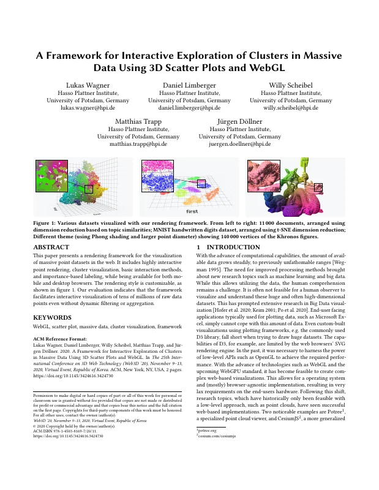
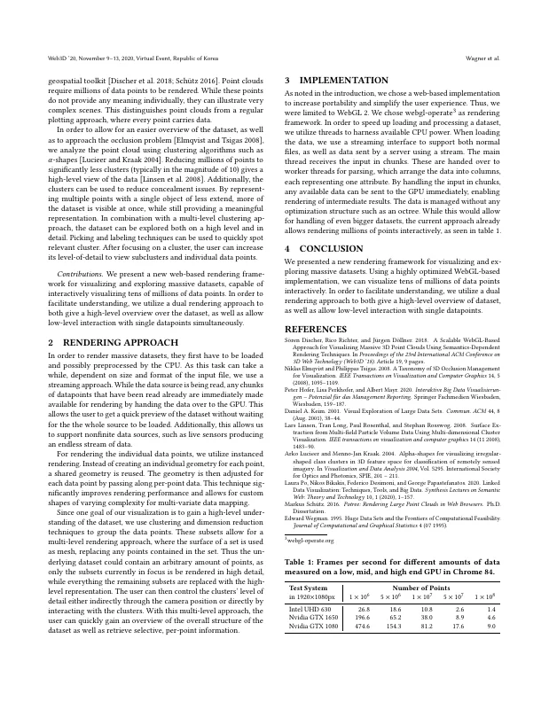

# A Framework for Interactive Exploration of Clusters in Massive Data Using 3D Scatter Plots and WebGL

[Lukas Wagner](https://orcid.org/0000-0002-5934-3310), [Daniel Limberger](https://orcid.org/0000-0002-9111-4809), [Willy Scheibel](https://orcid.org/0000-0002-7885-9857), [Matthias Trapp](https://orcid.org/0000-0003-3861-5759), and [Jürgen Döllner](https://orcid.org/0000-0002-8981-8583)

*Proceedings of the 25th International Conference on 3D Web Technology (Web3D '20)*, November 9–13, 2020, Virtual Event, Republic of Korea. ACM, pp. 31:1–2.

[](https://doi.org/10.1145/3424616.3424730) [](https://doi.org/10.5281/zenodo.24061447) [](https://www.researchgate.net/publication/345770726)

> This paper presents a rendering framework for the visualization of massive point datasets in the web.
> It includes highly interactive point rendering, cluster visualization, basic interaction methods, and importance-based labeling, while being available for both mobile and desktop browsers.
> The rendering style is customizable, as shown in figure 1.
> Our evaluation indicates that the framework facilitates interactive visualization of tens of millions of raw data points even without dynamic filtering or aggregation.

<p><a href="wagner2020-scatter-as-submitted.pdf"></a> <a href="wagner2020-scatter-as-submitted.pdf"></a></p>

## Contents

- [`src/`](src/) – LaTeX sources of the camera-ready version (ACM `acmart`, sigconf)
- [`wagner2020-scatter-as-submitted.pdf`](wagner2020-scatter-as-submitted.pdf) – camera-ready PDF as submitted to ACM
- [`slides/`](slides/) – LaTeX (beamer) sources of the Web3D 2020 talk
- [`wagner2020-scatter-slides.pdf`](wagner2020-scatter-slides.pdf) – talk slides as presented
- [`build.sh`](build.sh) – reproducible build with TeX Live 2020 (paper) and 2019 (slides), podman or docker
- [`preview/`](preview/) – page previews for this README

## Build

```bash
./build.sh        # → build/poster.web3d-scatter-plot.pdf
./build.sh slides # → build/slides/plotter.pdf
```

The bundled `acmart.cls` (v1.71, 2020) is built with the TeX Live 2020 container (the original PDF was produced with pdfTeX 1.40.20, i.e. TeX Live 2019).
On `main`, the build produces the revised version (`v1.1-revised`). Check out `v1.0-camera-ready` to reproduce `wagner2020-scatter-as-submitted.pdf` (identical text and layout; the figure caption differs marginally in glyph rendering).

The slides build (TeX Live 2019, pdfTeX 1.40.20 as the original) reproduces `wagner2020-scatter-slides.pdf` (identical text and layout; one screenshot on page 16 differs by a few pixels).

## Versions

- [`v1.0-camera-ready`](https://github.com/dl-archive/poster.2020-web3d-scatter-plot/tree/v1.0-camera-ready) – sources as submitted to ACM (2020-09-21)
- [`v1.1-revised`](https://github.com/dl-archive/poster.2020-web3d-scatter-plot/tree/v1.1-revised) – author's revised version (2026-11-08): grammar and reference fixes, see [Revisions](#revisions)

## Revisions

`v1.1-revised` (2026-11-08) corrects errors in the camera-ready version without changing its content or layout (the slides are unchanged).
Every page carries the note "Author's revised version (2026-11-08). Version of record: https://doi.org/10.1145/3424616.3424730".

- Grammar and word choice: "on the web", "Figure 1", "different theme" (Figure 1), "human comprehension", "e.g., the commonly used D3 library", "an OS- and (mostly) browser-agnostic implementation", "end users' hardware", "notable examples", "significantly fewer clusters", "less extent", "relevant clusters", "overview of the dataset", "depending on size and format", "the whole source" (duplicate "the"), "Thus, the underlying dataset", "are rendered in high detail, while the remaining subsets", "Table 1", "low-, mid-, and high-end GPU" (Table 1), "as the rendering framework", "as a mesh".
- Footnote links to potree.org, cesium.com, and webgl-operate.org now work (`\href` instead of `\hyperlink`).
- Author ORCIDs added to the sources (`\orcid`; acmart 1.71 does not print them in the sigconf format, so the PDF is unchanged).
- References: journal name capitalization and page range (Linsen et al.), month formatting (Linsen et al., Wegman), page range spacing (Lucieer and Kraak), Schütz 2016 is a master's thesis (TU Wien).

## Citation

```bibtex
@InProceedings{wagner2020-scatter,
  author    = {Wagner, Lukas and Limberger, Daniel and Scheibel, Willy and Trapp, Matthias and D{\"o}llner, J{\"u}rgen},
  title     = {A Framework for Interactive Exploration of Clusters in Massive Data using 3D Scatter Plots and WebGL},
  booktitle = {Proceedings of the 25th International Conference on 3D Web Technology},
  year      = {2020},
  series    = {Web3D~'20},
  publisher = {ACM},
  pages     = {31:1--2},
  doi       = {10.1145/3424616.3424730},
  isbn      = {978-1-450381-69-7},
}
```
